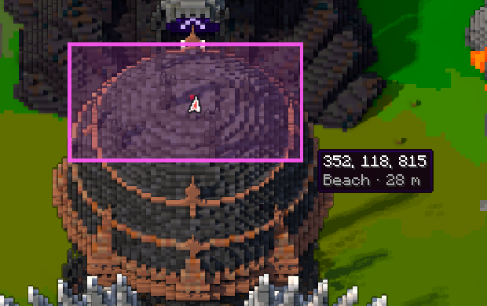
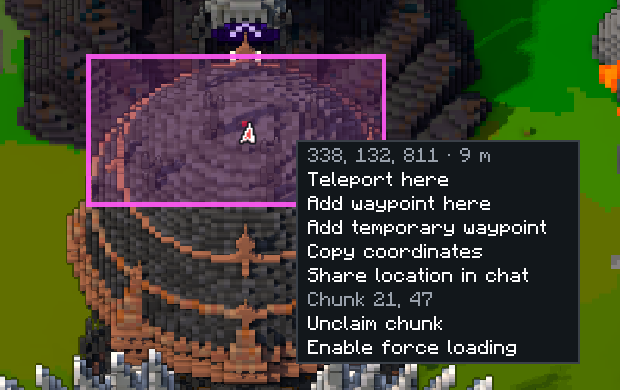
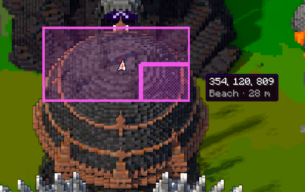
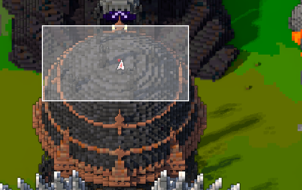
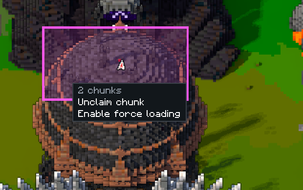
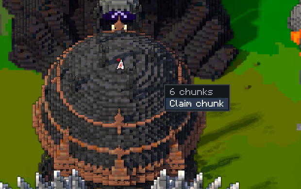
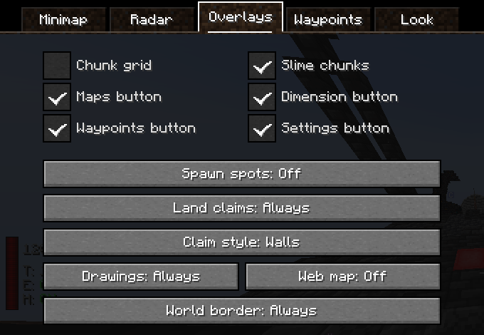
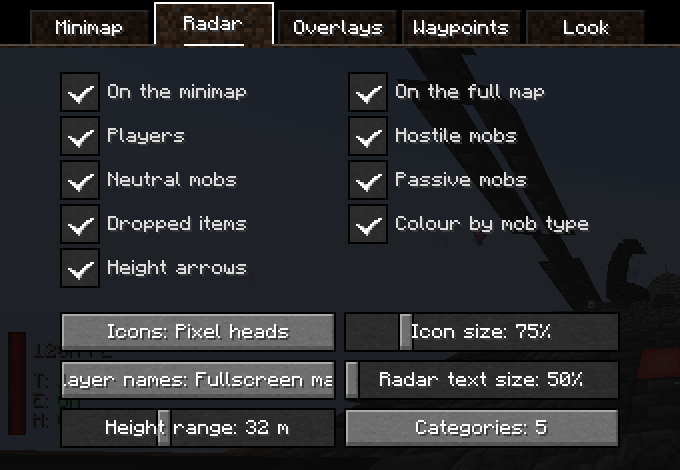

# Screenshots: FTB Chunks claiming, claim styles and radar text size

Taken on Minecraft 1.20.1 Forge, with FTB Chunks installed.

## 1. Claim style: Walls

Claims drawn as chunk-aligned borders at a fixed height instead of following the terrain. On the tilted 3D map the borders stay square and line up with the chunk grid, and they also show on cave layers. The Surface style (the previous behaviour) is still available.

## 2. Right-click a chunk: claim and force-load

The map's right-click menu gets a "Chunk x, z" section. It offers Claim or Unclaim chunk, and Enable or Disable force loading. The entries only appear when FTB Chunks is installed. The request is the same packet FTB Chunks' own map sends, so the server decides what is allowed.

## 3. Force-loaded chunks

A force-loaded chunk is drawn with a checker pattern in the owner's colour. In the Outline style only the border is drawn.

## 4. Right-drag to select an area

Dragging with the right mouse button highlights a rectangle of chunks. A selection is limited to 1024 chunks.

Releasing opens a menu for the whole area. On claimed chunks: Unclaim and Enable force loading.

On unclaimed chunks: Claim chunk.

## 5. Claim style setting

Overlays tab: Claim style cycles Surface, Ground outline and Walls.

## 6. Radar text size

Radar tab: a separate size for the names shown on the radar.
